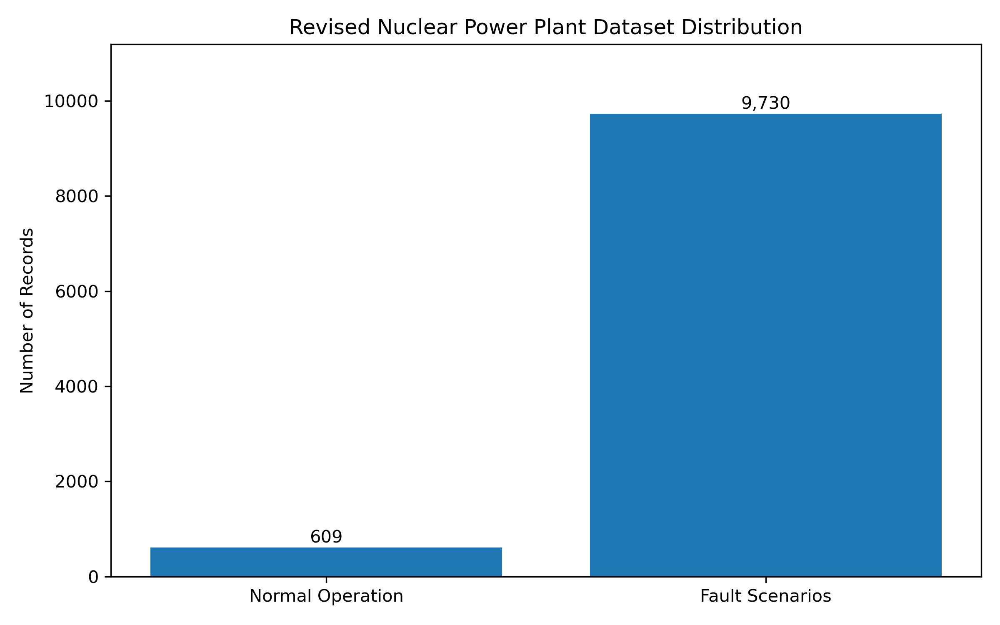
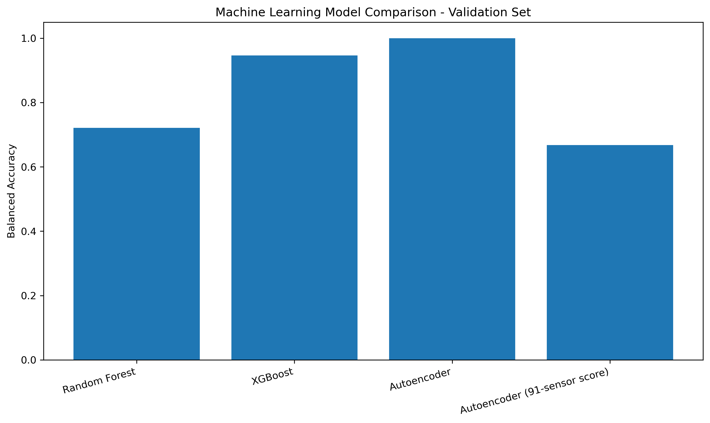
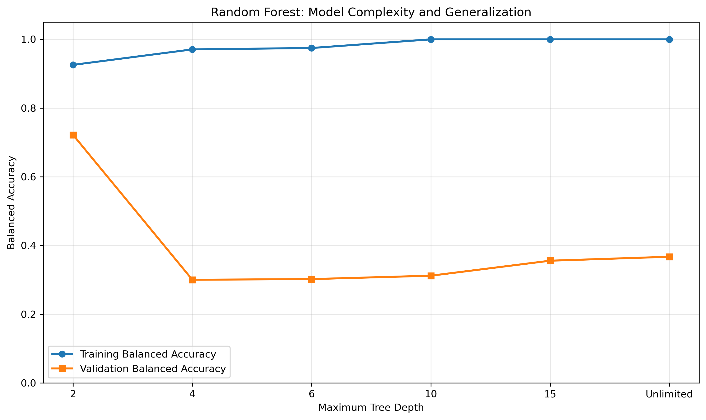
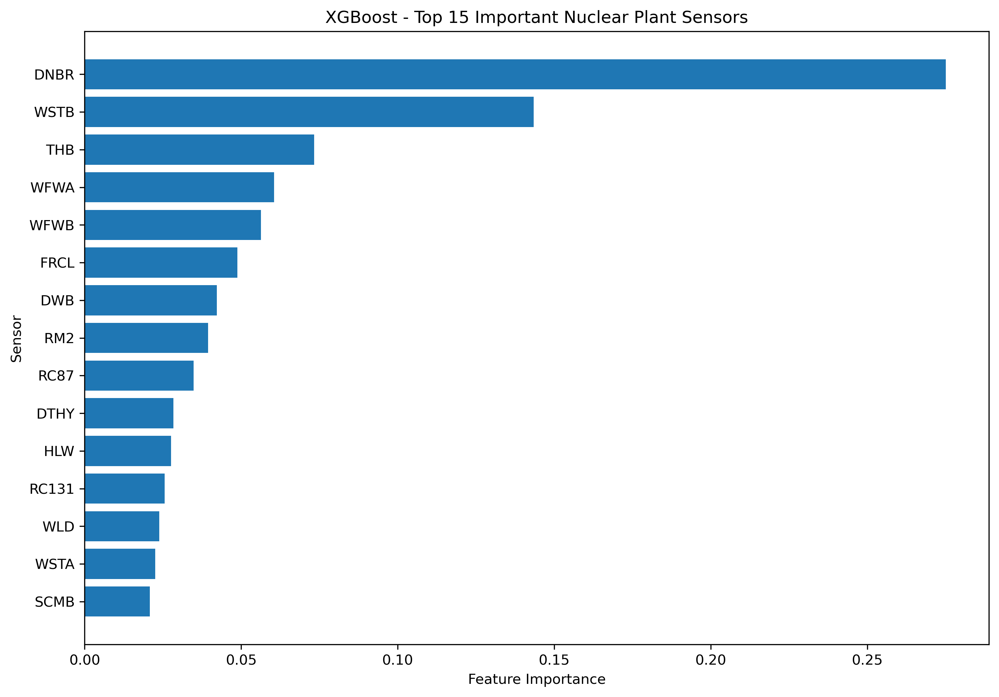

# ⚛️ Nuclear Power Plant Fault Detection Using Machine Learning

**MENG-4040-0NA · Machine Learning · November 2026**  
**Team:** Mohammed Zaid Quadri · Ameer Imwafi · Ahmed Junaid  
**Instructor:** Professor Weijing Ma

> **Research and education only.** This project uses PCTRAN-*simulated* data. It has not been validated on an operating nuclear power plant and **must not** be used for plant monitoring, protection, alarm decisions, or operational safety assessments.

## Project overview

**NPP Sentinel AI** is a research prototype for detecting *normal operation (0)* versus *fault-labelled simulation conditions (1)* using 96 numerical sensor measurements. We investigate the limits of record-level binary classification, not verified physical fault-onset detection.

The project includes:

- **Four machine-learning approaches:** Random Forest, XGBoost, Isolation Forest (earlier exploratory experiment), and a PyTorch Autoencoder.
- Exploratory data analysis, data-quality checks, class-imbalance analysis, and scenario-aware evaluation.
- Model complexity and hyperparameter experiments, feature ablation, feature importance, error analysis, and robustness checks.
- A **Streamlit dashboard** with light-theme charts, recorded scenario replay, three-model predictions, research results, stress testing, and a **five-stage Guided Demo Mode**.

**Research question:** Can models distinguish simulated nuclear plant malfunction records from normal records, and how reliably do they generalize to previously unseen *fault scenario types*?

## Dataset

Source: [SFStefenon/NPPmalfunctions](https://github.com/SFStefenon/NPPmalfunctions) (PCTRAN simulation). Please consult the original dataset source for provenance and reuse conditions.

| Dataset stage | Records | Normal | Fault-labelled | Notes |
|---|---:|---:|---:|---|
| Original combined data | 12,171 | 609 | 11,562 | 96 sensors + metadata |
| Prepared exploratory data | 12,152 | 609 | 11,543 | Removed shared initial record from fault scenarios |
| **Revised experimental data** | **10,339** | **609** | **9,730** | 17 scenarios: one normal + 16 retained faults |

The raw files included a reserved scenario (ID 13), excluded from binary model construction. Three further fault-labelled scenarios—**05** (Spark Presence for Hydrogen Burn), **08** (Anticipated Transient without Scram), and **14** (Moderator Dilution)—had sensor traces identical to normal-operation records at matching times in our inspection. They were **excluded from the revised training/evaluation dataset, but retained for stress testing**. Their exclusion makes the revised classification task narrower; it does not resolve the underlying observability limitation.

**Features:** All 96 numerical sensor columns; `TIME`, `Scenario`, `Scenario_ID`, and `Label` are excluded from prediction features to prevent direct target/metadata leakage.



## Model development and evaluation

### Learning approaches

| Approach | Category | Role |
|---|---|---|
| Random Forest | Supervised ensemble / bagging | Baseline; class weighting and tree-depth experiments |
| XGBoost | Supervised gradient boosting | Main tree-based classifier; hyperparameter search and feature importance |
| Isolation Forest | Unsupervised anomaly detection | Original exploratory normal-only anomaly experiment; not a selectable model in the final dashboard |
| Autoencoder | Neural-network reconstruction / anomaly detection | Learned reconstruction of normal data; threshold on mean-squared reconstruction error |

The corrected Autoencoder uses a **signed-log transform → RobustScaler fitted on training data → clipping to [-10, 10]**. Its network dimensions are **96 → 64 → 32 → 16 → 32 → 64 → 96**. It is trained on normal training records only. **The scaler is fitted to the entire training partition (normal + fault),** so the *pipeline* must not be described as fully unsupervised or normal-only. Early stopping monitors normal validation reconstruction loss. Anomaly threshold is the 99th percentile of normal training reconstruction errors.

### Scenario-aware train/validation/test split

For the final advanced experiment, the **16 retained fault scenarios** were partitioned without overlap: **10 training, 3 validation, 3 test**. Normal measurements were divided chronologically (about 60% / 20% / 20%) from **one normal run**. The final test fault scenario IDs were **01, 02, and 16**; validation held out **07, 18, and 19**.

This supports *held-out fault-type evaluation* but **does not provide independent normal-run validation**. Samples within each simulation are temporally correlated. The number of unique scenarios is more informative than the raw number of records when assessing independent evidence.

### Final advanced comparison

**Balanced accuracy** is the mean of *normal recall (specificity)* and *fault recall (sensitivity)*; it is preferable to raw accuracy for these imbalanced labels.

| Model | Validation balanced accuracy | Held-out test balanced accuracy |
|---|---:|---:|
| Random Forest (max depth 2) | 72.16% | 89.88% |
| XGBoost (150 trees, depth 5, learning rate 0.03) | 94.67% | **100.00%** |
| Autoencoder (full 96-sensor reconstruction score) | **100.00%** | **100.00%** |

The test set contained **1,945 records** (122 later normal records and 1,823 records from the three held-out fault scenarios). XGBoost and Autoencoder classified all selected test records correctly. **This is not evidence of perfect reliability under independent simulation initial conditions, real operating transients, other reactors, or real safety conditions.** The models and decision rules were selected before this test evaluation.



### Robustness and important negative findings

- **Autoencoder sensor sensitivity:** Recalculating its anomaly score *without five sensors* (`RM1`, `STRB`, `DWB`, `RM4`, `DTHY`) reduced validation balanced accuracy from **100.00% to 66.81%**. The network itself was **not retrained** for this check; it measures sensitivity of the reconstruction-error score, not performance of a separately trained 91-feature network.
- **Random Forest fault-type dependence:** It classified only **40.75%** of records in test fault scenario **16**, despite doing very well on held-out coolant-loss scenarios **01** and **02**.
- **Original four-fold scenario comparison (different experiment):** mean balanced accuracy **45.35%** for Random Forest and **82.87%** for XGBoost. These are **not** the final test numbers; each fold reused a later segment of the same normal run.
- **Exploratory Wilcoxon test:** one-sided paired signed-rank **p = 0.0625** over four correlated folds, **not significant** at α = 0.05 and not confirmatory evidence of superiority.
- **Feature ablation (earlier experiment):** 15, 30, and 96 feature setups each obtained **82.87%** mean scenario-CV balanced accuracy; the 5-feature setup obtained **70.61%**. Feature selection was fold-dependent and this does not verify a universal 15-feature deployment model.
- **Original labelled-data conflicts:** Excluded fault scenarios 05, 08, and 14 can be classified as normal because their observed inputs are indistinguishable from normal data. No sensor-only classifier can reliably separate contradictory labels for identical inputs.





Feature importance reflects model utilization of predictors, **not causal attribution** or certified physical diagnosis.

## Dashboard: NPP Sentinel AI

Start the dashboard to replay **recorded simulations** and inspect predictions. It is **not a live plant-data connection**.

- **Plant Monitor:** scenario selection, record-position slider, recorded sensor metrics, and sensor time-series trends.
- **AI Diagnostics:** Random Forest, XGBoost, and Autoencoder predictions; XGBoost fault score; Autoencoder reconstruction error and threshold; feature importance.
- **Research Results:** validation/test balanced accuracy, held-out scenario comparisons, and limitations.
- **Stress Testing:** representative records from excluded scenarios 05, 08, and 14.
- **Guided Demo Mode:** five-stage instructional walkthrough alongside the standard Explore Mode.

A fault score from `predict_proba` is **not a calibrated probability of a real accident**. Alert thresholds are experimental, not an industrial alarm specification.

### Quick start (Windows / Jupyter users)

From the **project root directory**, install dependencies and launch Streamlit:

```powershell
python -m pip install -r requirements.txt
python -m streamlit run app.py
```

Open the local URL shown by Streamlit (typically `http://localhost:8501`). To use another port:

```powershell
python -m streamlit run app.py --server.port 8504
```

**Optional — launch from a Jupyter code cell** while your notebook's working directory is the project root:

```python
import subprocess, sys
from pathlib import Path
subprocess.Popen([sys.executable, '-m', 'streamlit', 'run', str(Path.cwd() / 'app.py'), '--server.port', '8504'])
print('Open http://localhost:8504')
```

If a port is already occupied, use a different one. For reproducibility, a separate virtual environment is recommended.

### Files required for dashboard inference

The final dashboard needs both prepared CSVs (the original prepared file for stress tests), the seven advanced model/configuration files, and the result tables for the research view. The following are especially important:

```text
prepared_data/npp_revised.csv
prepared_data/npp_prepared.csv
models/advanced_random_forest.pkl
models/advanced_xgboost.pkl
models/advanced_autoencoder.pth
models/advanced_autoencoder_robust_scaler.pkl
models/advanced_feature_names.pkl
models/advanced_autoencoder_metadata.json
models/advanced_experiment_summary.json
results/final_advanced_experiment_summary.csv
results/advanced_test_scenario_results.csv
```

> **Security:** Only deserialize `.pkl` or `.joblib` files from trusted sources; these file formats can execute arbitrary code when loaded.

## Reproduce the research

Run notebooks **in order** from the repository root:

1. `01_Dataset_Exploration.ipynb` — raw PCTRAN spreadsheet exploration and prepared data (download the source dataset separately if rebuilding from raw files).
2. `02_Model_Development.ipynb` — exploratory supervised/unsupervised comparisons, revised data, scenario CV, feature ablation, and statistical analysis.
3. `03_Advanced_Model_Experiments.ipynb` — scenario-disjoint train/validation/test sets, model-complexity and XGBoost tuning, corrected Autoencoder, robustness check, final held-out evaluation and exported advanced model artifacts.

Some notebook cells depend on variables computed by previous cells. **Restart the kernel and run cells sequentially** when reproducing. The final notebook also contains figure generation and a dependency-file utility; rerunning it may overwrite outputs. Original and advanced experiments should remain clearly labeled because they use different data partitions and sometimes different preprocessing.

### Key repository structure

```text
.
├── 01_Dataset_Exploration.ipynb
├── 02_Model_Development.ipynb
├── 03_Advanced_Model_Experiments.ipynb
├── app.py
├── requirements.txt
├── README.md
├── .gitignore
├── prepared_data/             # original prepared + revised CSVs
├── models/                    # original + advanced saved models/configuration
├── results/                   # numerical tables and plots
├── scripts/                   # original preparation/testing helpers
└── docs/                      # methodology, report and presentation
```

## Limitations, risk and future work

1. **Simulation-only evidence:** No measured plant operating data or regulatory validation.
2. **One normal scenario:** Normal generalization across plant loads, initial states, and separate simulations remains untested.
3. **Time correlation:** Thousands of records are not thousands of independent runs.
4. **Scenario-label ambiguity:** Folder labels do not establish precisely when the underlying fault became observable.
5. **Data observability:** Three excluded fault-labelled scenarios are indistinguishable from normal inputs in the dataset.
6. **Preprocessing/model sensitivity:** The Autoencoder's high scores depend on sensor selection and transformations; clipping changes the anomaly-score behavior.
7. **Safety context:** Both false negatives (missed fault-labelled records) and false positives (false alarms) matter. The prototype must not be used for reactor monitoring, operator instructions or safety-critical decisions.

Future investigation should use repeated independent normal/fault simulations, varied operating points, validated event-onset annotations, time-to-detection metrics, calibration, uncertainty estimation, sensor-failure experiments, and independent test conditions. Any real-world application would additionally require qualified nuclear-engineering review and formal safety assurance.

## Documentation and references

- **Final research report:** see `docs/` for the updated Word document.
- **Project presentation:** see `docs/` for the updated PowerPoint deck.
- **Dataset:** [SFStefenon / NPPmalfunctions](https://github.com/SFStefenon/NPPmalfunctions).
- Breiman, L. (2001). *Random Forests*. *Machine Learning*, 45, 5–32. https://doi.org/10.1023/A:1010933404324
- Chen, T., & Guestrin, C. (2016). *XGBoost: A Scalable Tree Boosting System*. *KDD*. https://doi.org/10.1145/2939672.2939785
- Liu, F. T., Ting, K. M., & Zhou, Z.-H. (2008). *Isolation Forest*. *ICDM*. https://doi.org/10.1109/ICDM.2008.17

**Academic scope:** This repository is a reproducible course research demonstration, not a validated nuclear plant diagnostic system.
